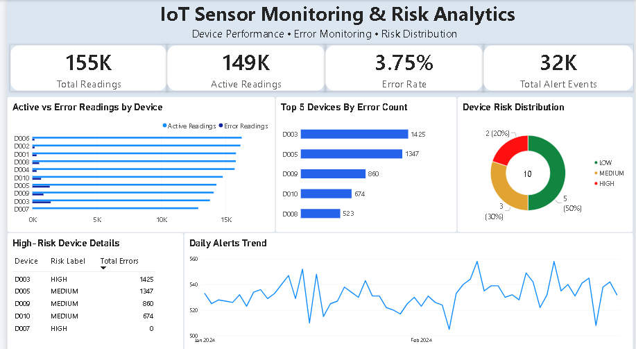

# IoT Sensor Data Pipeline & Risk Analytics

An end-to-end IoT sensor data pipeline built using **Databricks, PySpark, Delta Lake, Auto Loader, Medallion Architecture, and Power BI**. The project processes sensor readings, applies data-quality checks, generates device-level risk analytics, and presents monitoring insights through an interactive dashboard.

## Project Overview

This project simulates an IoT monitoring workflow using CSV sensor data batches. Data is ingested into the Bronze layer, validated and cleaned in Silver, and transformed into analytical Gold tables for reporting and visualization.

## Architecture

**CSV Sensor Data → Bronze → Silver → Gold → Power BI**

- **Bronze Layer:** Ingests raw CSV batches using Databricks Auto Loader and Delta tables, with ingestion metadata.
- **Silver Layer:** Casts data types, validates sensor readings, quarantines invalid records, and deduplicates valid data.
- **Gold Layer:** Generates device-level metrics, hourly trends, daily alert summaries, and device risk analytics.
- **Power BI:** Visualizes sensor activity, error rates, alert trends, and device risk distribution.

## Technologies Used

- Databricks
- PySpark
- Spark SQL
- Delta Lake
- Databricks Auto Loader
- Unity Catalog
- Medallion Architecture
- Power BI
- DAX

## Data Quality Results

The pipeline processed **172,800 raw sensor records** and produced the following Silver-layer results:

| Metric | Result |
|---|---:|
| Raw records ingested | 172,800 |
| Valid records | 155,305 |
| Quarantined records | 17,495 |
| Silver pass rate | 89.88% |

Invalid records are quarantined rather than included in the validated Silver dataset.

## Gold Analytics

The Gold layer provides analytical tables for:

- Device-level readings, temperature, humidity, errors, and alerts
- Hourly sensor trends
- Daily alert summaries
- High-risk device details
- Device risk distribution

The risk model combines error rate, alert rate, and average temperature to assign device risk categories.

## Power BI Dashboard

The **IoT Sensor Monitoring & Risk Analytics** dashboard includes:

- Total readings and active readings
- Overall error rate and total alert events
- Active versus error readings by device
- Top five devices by error count
- Device risk distribution
- High-risk device details
- Daily alert trends



## Repository Structure

```text
iot-sensor-data-pipeline/
├── dataset/
│   ├── iot_batch_01_jan01_jan20.csv
│   ├── iot_batch_02_jan21_feb10.csv
│   └── iot_batch_03_feb11_mar01.csv
├── powerbi/
│   ├── IOT_Dashboard.pbix
│   └── IOT_Dashboard_Screenshot.png
├── Bronze_Ingestion.py
├── Silver_Processing.py
├── Gold_Analytics.py
├── Project_Setup.py
└── README.md
```

## How to Explore

1. Review `Project_Setup.py` to understand the initial project configuration.
2. Explore `Bronze_Ingestion.py` to understand raw data ingestion.
3. Review `Silver_Processing.py` for data validation, quarantine handling, and deduplication.
4. Explore `Gold_Analytics.py` to understand the analytical tables and device risk metrics.
5. Open `powerbi/IOT_Dashboard.pbix` in Power BI Desktop to explore the dashboard.

The notebooks are designed for Databricks. Catalogs, schemas, volumes, source paths, checkpoints, and workspace permissions may need to be configured before running the pipeline in another environment.

## Project Highlights

- Developed a multi-layer data pipeline using Bronze, Silver, and Gold architecture.
- Implemented data-quality validation and quarantine handling for invalid sensor records.
- Created Gold-layer analytics for device performance, alerts, and risk classification.
- Built a Power BI dashboard to monitor sensor activity, errors, alerts, and device risk distribution.

---

**Author:** Satyam  
**Project:** IoT Sensor Data Pipeline & Risk Analytics
